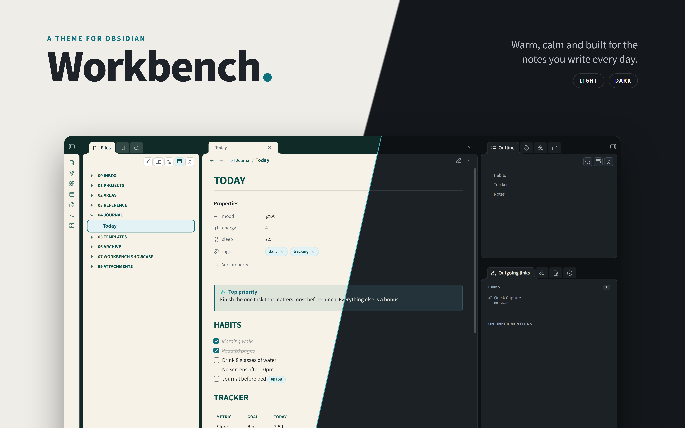
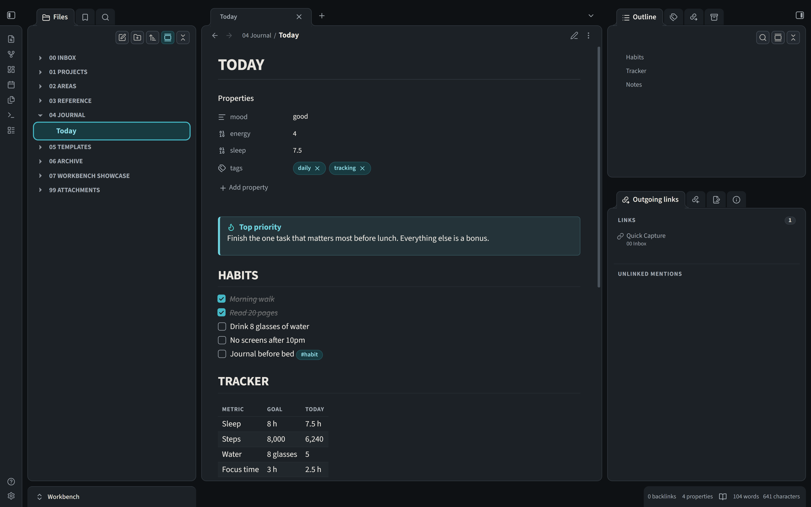
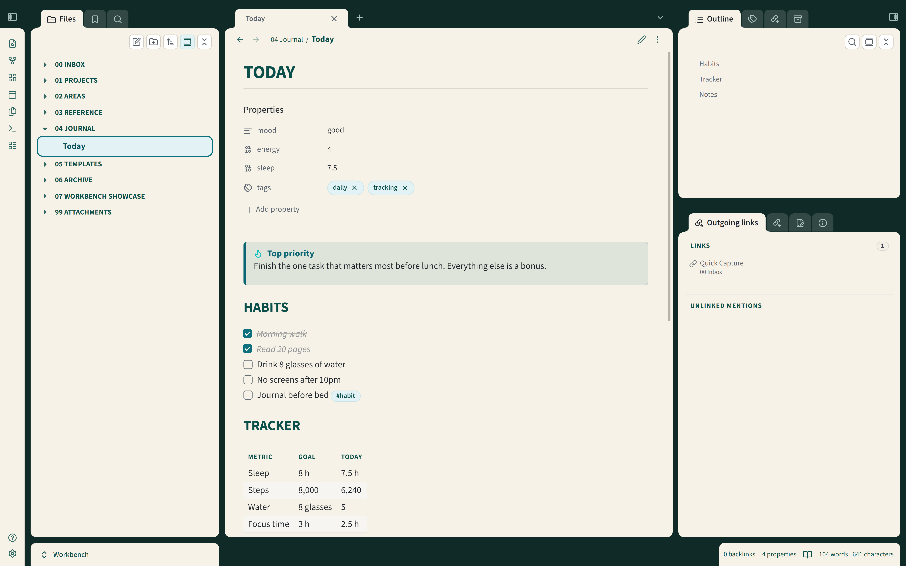
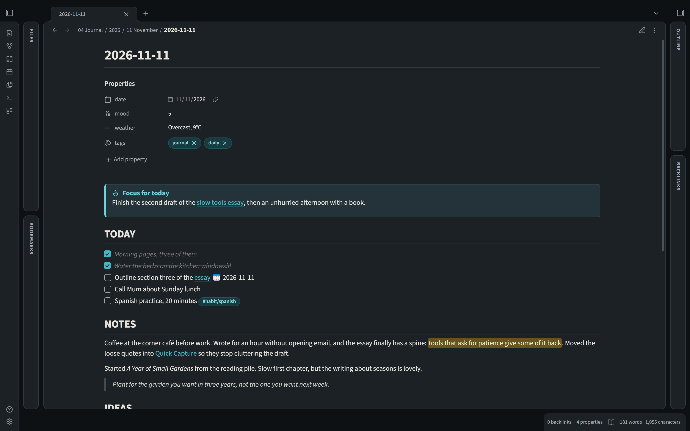
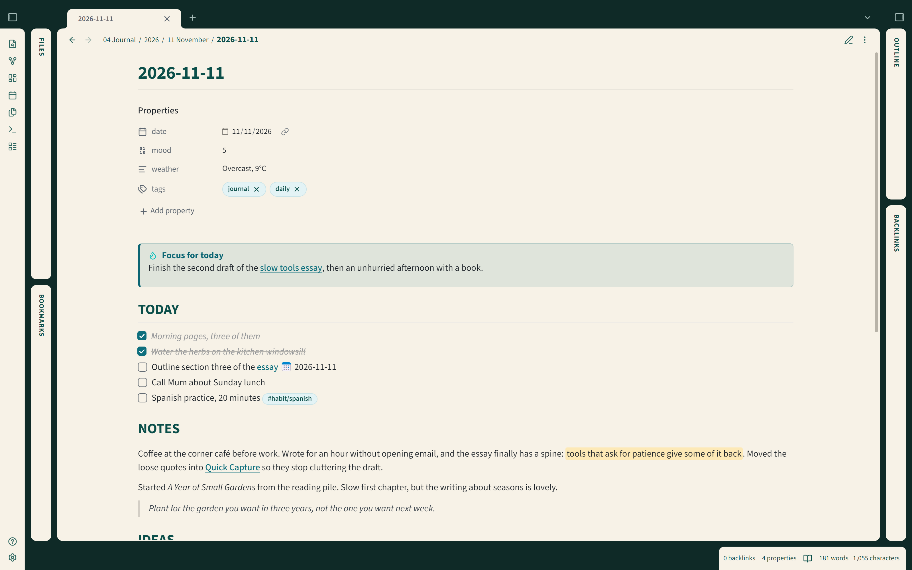
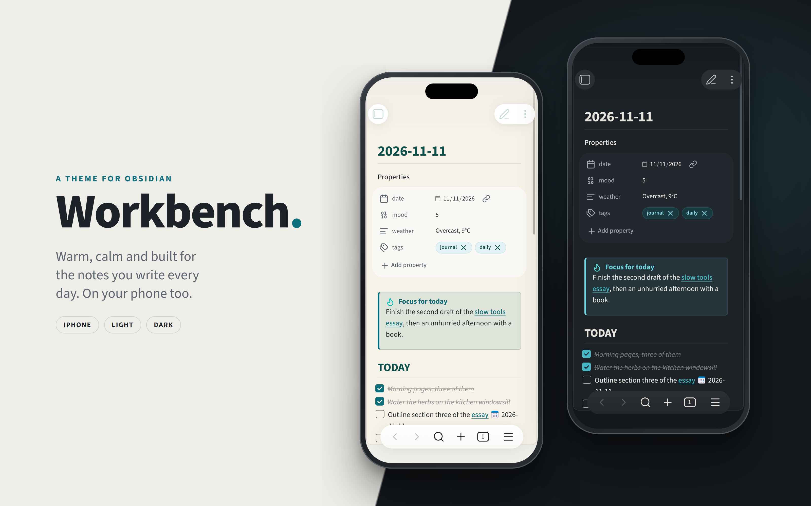

# Workbench for Obsidian

A calm, tidy theme for Obsidian. Workbench gives your notes warm parchment panels, deep green
headings and a dark top bar, and it looks just as good in dark mode. It's designed for
Windows, macOS, iPad and iPhone. Android devices _should_ work too, but I haven't tested on those.

It's based on [Workbench UI](https://github.com/MartynKeigher/workbench-ui), so if you use that elsewhere, Obsidian will feel right at home.

## Getting started

~~Workbench isn't in Obsidian's theme gallery just yet, so for now you'll add it by hand. It only takes
a minute:~~

~~1. Open your vault's folder and find the hidden `.obsidian` folder inside it. In there, open (or
   create) a `themes` folder, then make a new folder inside that called `Workbench`.
2. Download `theme.css` and `manifest.json` from this page and drop them into the `Workbench`
   folder.
3. In Obsidian, go to **Settings → Appearance → Themes** and pick **Workbench**.~~ 

Click on 'Install and Use' above! 

That's it! 🎉

### Light or dark?

On the same Appearance page, use **Base color scheme** to choose light or dark. Or pick **Adapt to
system** and Workbench will follow whatever your computer or phone is set to.

### Fonts

Workbench comes with **Source Sans 3** for your notes and menus and **Source Code Pro** for code, both
built in, so everything looks right straight away with nothing to install.

## To-Do

- [ ] Build the **Workbench Companion** plugin

The Companion is a small plugin that will add settings, plus a few things a theme can't do on its
own:

- [ ] Fold and unfold code blocks
- [ ] Show or hide the icons in the file list
- [ ] Show or hide the level lines in the file list
- [ ] Choose the folder label style and size
- [ ] Switch between floating cards and flat, edge-to-edge panels
- [ ] Choose compact, comfortable or roomy spacing
- [ ] Adjust the heading style, including underlines and capitals
- [ ] Switch between light and dark in one click
- [ ] Pick from more color palettes
- [ ] Click anywhere on a minimized sidebar to open it again

## ☕ Support

Workbench is free and always will be. If it makes your notes a nicer place to be and you'd like to
say thanks, you can [buy me a coffee](https://www.buymeacoffee.com/martynkeigher). It's never
expected, but always appreciated!

Spotted a problem? The [issue tracker](https://github.com/MartynKeigher/obsidian-workbench/issues) is the best place
for it, so nothing gets lost. For a quick chat or a question, I'm on the Obsidian Discord too, as
**MartynKeigher**.

## Screenshots

## Contributing

Want to tinker with the theme? Everything you need is in [CONTRIBUTING.md](CONTRIBUTING.md).

## License

MIT, so you're free to use it however you like. The built-in Source Sans 3 and Source Code Pro fonts are
© Adobe and come under the SIL Open Font License ([Source Sans 3](theme/fonts/OFL.txt),
[Source Code Pro](theme/fonts/OFL-Source-Code-Pro.txt)).
